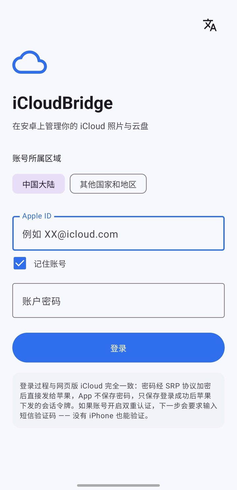
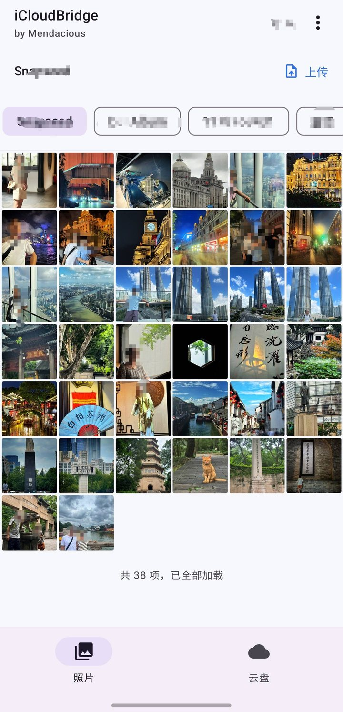
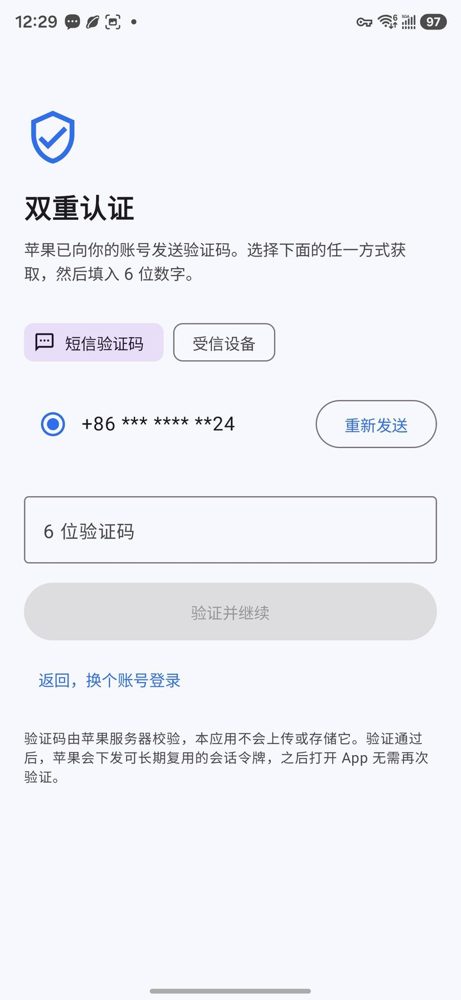
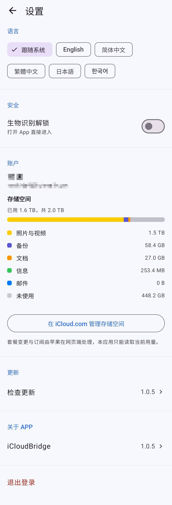
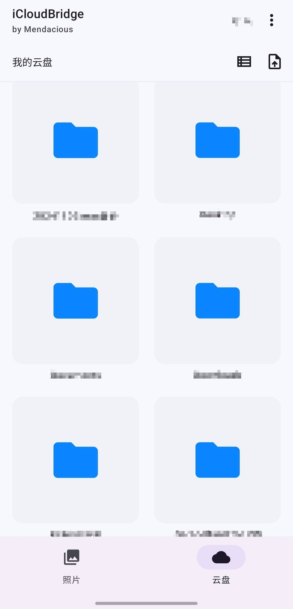

# iCloudBridge

**Unofficial Android client for iCloud Photos and iCloud Drive**
**非官方 iCloud 相册与云盘安卓客户端**

`Kotlin` · `Jetpack Compose` · `MIT` · `Android 8.0+`

<p align="center">
  
</p>

---

## 🎯 什么时候用得上 · When this helps

- **从 iPhone 换成安卓，照片却还锁在 iCloud 里**
  换机助手只搬通讯录和短信，「iCloud → 安卓」这条路它从来没管过。装好之后，几千张老照片和存档文件随时能翻，需要哪张当场存进手机。<br>
  *You switched to Android, but years of photos are still sitting in iCloud. No migration tool ever covered that gap — the old library is now one tap away, and anything you need lands in your phone.*

- **iPhone 和安卓双持**
  一台工作、一台生活，照片和文件却得在两个系统之间来回跑。不用再「发给自己」或者绕道网盘，两边都能直接取。<br>
  *One phone for work, one for life. Photos and files need to cross over both ways — no more "send to myself", no more relaying through a cloud drive.*

- **受不了安卓浏览器里的网页版 iCloud**
  相册翻页卡、缩放别扭、视频动不动黑屏。原生界面顺手得多：双指捏合调缩略图，左右划着看完整库。<br>
  *The iCloud website on Android is rough — paging stutters, pinch-to-zoom feels wrong, videos barely play. A native app simply does it properly.*

- **想在安卓平板或大屏上看 iCloud 照片**
  不用投屏、不用先导出来。装上就是全屏相册，翻起来很顺。<br>
  *Bring the library to an Android tablet and actually see it — no casting, no exporting first.*

- **电脑不在手边，临时要取 iCloud Drive 里的一份文件**
  手机上直接翻到、下载到本地，再转发给对方。<br>
  *You're away from your computer and a file in iCloud Drive is needed right now. Find it, download it, forward it.*

- **想把资料慢慢搬回自己手里**
  不必一次搬完。把 iCloud 当成只读的来源，哪天想起哪张照片、哪份文件，就下载到安卓手机里存着。<br>
  *Ease out of a single ecosystem at your own pace. Treat iCloud as a read-only source and pull things down to the phone whenever you need them.*

---

## 🔒 隐私 · Privacy

**中文** —— 你的数据只在你和 iCloud 之间流动，没有任何第三方服务器中转；会话令牌用 AndroidKeyStore + AES-256-GCM 加密后存在本机，密码从不保存，没有统计 SDK，也没有行为埋点。<br>
**不会收集、上传或分享你的任何信息。**

**English** — Your data moves only between your phone and iCloud; no third-party server sits in the middle. Session tokens are encrypted on-device with AndroidKeyStore + AES-256-GCM, your password is never stored, and there is no analytics SDK or behavioural tracking.<br>
**Nothing about you is collected, uploaded, or shared.**

---

## ⚠️ Before you start · 使用前必读

**English** — Your Apple ID must allow **web access**. On iPhone or iPad:
*Settings → [your name] → iCloud → iCloud.com → turn on "Allow Data Access"*
(on iOS 18 and earlier: *Settings → [your name] → iCloud → turn on "Access iCloud
Data on the Web"*). If the switch is off, you will sign in but see no photos or files.

Accounts with **Advanced Data Protection** cannot use this app — that data is
end-to-end encrypted, and no web client can read it.

**中文** —— 必须先允许**网页访问**你的 iCloud 数据。在 iPhone 或 iPad 上：
*设置 → 你的姓名 → iCloud → iCloud.com → 打开「允许数据访问」*
（iOS 18 及更早版本：*设置 → 你的姓名 → iCloud → 打开「在网页上访问 iCloud 数据」*）。
这个开关关着的话，登录能成功，但相册和云盘会是空的。

开启了「**高级数据保护**」的账号无法使用本应用 —— 那是一套端到端加密，任何网页客户端都读不到。

---

## English

### What it does

| | |
|---|---|
| **Photos** | Album list, pinch-to-zoom grid, full-screen viewer that pages left/right across the whole library |
| **Live Photos** | `LIVE` badge in the grid; motion plays from the viewer |
| **Video** | Tap to play, with a control bar for play/pause and seeking |
| **Upload** | Photos and videos into iCloud Photos; any file into iCloud Drive |
| **Drive** | Browse folders, download to the device, upload, delete |
| **Sign-in** | Regular Apple ID + two-factor authentication; the session is reused, so 2FA is needed once |
| **Security** | Session tokens encrypted with AndroidKeyStore + AES-256-GCM; optional biometric app lock |
| **Languages** | English, 简体中文, 繁體中文, 日本語, 한국어 |

<p align="center">
  <br>
  <sub>The whole library in one grid — tap to open, swipe to keep going</sub>
</p>

### Install

1. Open [Releases](https://github.com/Mendacious9/iCloudBridge/releases) and download
   the latest `app-release.apk`.
2. Tap the file on your phone and allow *Install unknown apps* for your browser or
   file manager when prompted.
3. Open **iCloudBridge** and sign in with your Apple ID.
4. Approve the two-factor prompt on a trusted device (or by SMS).

<p align="center">
  <br>
  <sub>First launch only — SMS works even without an iPhone at hand</sub>
</p>

Requires Android 8.0 or newer. The APK is not on any app store, so updates happen
inside the app: *Settings → Update → Check for updates*.

If no release has been published yet, build it yourself —
see [docs/BUILD.zh-CN.md](docs/BUILD.zh-CN.md).

<p align="center">
  <br>
  <sub>Settings: languages, app lock, storage breakdown, in-app update</sub>
</p>

### Using it

- **Photos** — tap any thumbnail for full screen; swipe left or right to keep going
  through the entire library, photos and videos alike. Pinch the grid to change the
  thumbnail size.
- **Live Photos** — items with a `LIVE` badge on the thumbnail can play their motion;
  open one and tap the `LIVE` button in the top bar.
- **Video** — plays in place; tap the screen to show the control bar, drag the slider
  to seek.
- **Download** — in the viewer, use the download button in the top bar. Photos land in
  `Pictures/iCloudBridge`, videos in `Movies/iCloudBridge`.
- **Upload** — the upload button in the photo grid picks from your phone; in Drive,
  it uploads any file into the current folder.
- **Drive** — browse folders, download a file to `Download`, or delete it.
- **App lock** — optional fingerprint or face unlock in Settings.
- **Updates** — Settings → Update → Check for updates.

<p align="center">
  <br>
  <sub>Drive page: folders, upload, download, delete</sub>
</p>

### Known limitations

- The photo library is effectively read-only: no album creation, no per-asset delete.
- Video upload only accepts codecs Apple can transcode (H.264/HEVC); anything else is
  rejected with a clear message.
- Drive uploads have no resume.

### Disclaimer

Not affiliated with, endorsed by, or supported by Apple Inc. "iCloud" is a trademark
of Apple Inc., used here only to describe interoperability. Provided free of charge,
as-is, without warranty of any kind — use at your own risk. If a photo or file exists
only in iCloud, do not rely on this app as your sole means of accessing it.

---

## 中文

### 能做什么

| | |
|---|---|
| **相册** | 相册列表、双指缩放网格、全屏查看器，左右滑动可跨整库连续翻页 |
| **实况照片** | 缩略图左下角 `LIVE` 角标，查看器内可播放动态 |
| **视频** | 点开即播，自绘控制条支持播放/暂停与进度拖动 |
| **上传** | 照片、视频上传进 iCloud 照片图库；任意文件上传到 iCloud 云盘 |
| **云盘** | 目录浏览、下载到本机、上传、删除 |
| **登录** | 普通 Apple ID + 双重认证；会话可复用，2FA 只需过一次 |
| **安全** | 会话令牌用 AndroidKeyStore + AES-256-GCM 加密落盘；可选指纹 / 人脸应用锁 |
| **多语言** | 英文、简体中文、繁體中文、日本語、한국어 |

<p align="center">
  <br>
  <sub>整个图库铺在一个网格里，点开就能一直左右滑下去</sub>
</p>

### 安装

1. 打开 [Releases](https://github.com/Mendacious9/iCloudBridge/releases)，下载最新的
   `app-release.apk`。
2. 在手机上点开这个文件；系统询问时，给你的浏览器或文件管理器打开
   「安装未知应用」权限。
3. 打开 **iCloudBridge**，用 Apple ID 登录。
4. 在受信设备上确认双重认证（或改用短信验证码）。

<p align="center">
  <br>
  <sub>只有首次需要，身边没有 iPhone 也能用短信验证</sub>
</p>

要求 Android 8.0 以上。本应用不上任何商店，更新在应用内完成：
*设置 → 更新 → 检查更新*。

如果 Releases 里还没有可下载的包，可以自己编译，见
[docs/BUILD.zh-CN.md](docs/BUILD.zh-CN.md)。

<p align="center">
  <br>
  <sub>设置：多语言、应用锁、存储空间构成、应用内更新</sub>
</p>

### 怎么用

- **看照片** —— 点任意缩略图进入全屏，左右滑动可以一直翻下去，照片和视频混在一起。
  在网格上双指捏合能改变缩略图大小。
- **实况照片** —— 缩略图带 `LIVE` 角标的才有动态；进全屏后点顶栏的 `LIVE` 按钮播放，
  约 3 秒后自动回到静态。
- **视频** —— 点开即播；点一下画面调出控制条，拖进度条可以跳转。
- **下载** —— 全屏查看器顶栏的下载按钮。照片存到 `Pictures/iCloudBridge`，
  视频存到 `Movies/iCloudBridge`。
- **上传** —— 相册页的上传按钮从手机里挑照片或视频；云盘页则把任意文件传进当前目录。
- **云盘** —— 浏览目录、下载到 `Download`、删除文件。
- **应用锁** —— 设置里可开指纹或人脸解锁。
- **更新** —— 设置 → 更新 → 检查更新。

<p align="center">
  <br>
  <sub>云盘页：文件夹、上传、下载、删除</sub>
</p>

### 已知限制

- 相册基本只读：不能新建相册，也不能单张删除。
- 视频上传只接受苹果能转码的编码（H.264 / HEVC），其他格式会被明确拒收。
- 云盘上传不支持断点续传。

### 免责声明

本项目与 Apple Inc. 无任何关联，未获其授权或认可。"iCloud" 是 Apple Inc.
的商标，此处仅用于说明互通对象。本项目免费、按原样提供，不附带任何担保，
使用风险自负。若某张照片或某个文件只存在于 iCloud，请勿将本应用作为唯一的
取用途径。

---

## For developers · 开发者

Build, signing, release flow and protocol notes:

- [docs/BUILD.zh-CN.md](docs/BUILD.zh-CN.md) — 构建、签名、发版、测试
- [docs/PROTOCOL.zh-CN.md](docs/PROTOCOL.zh-CN.md) — 协议笔记（上传、实况照片、播放器、会话恢复）

```bash
echo "sdk.dir=/path/to/Android/sdk" > local.properties
./gradlew :app:assembleDebug      # → app/build/outputs/apk/debug/
./gradlew :core:icloud:test       # protocol unit tests, plain JVM
```

`core/icloud` is a pure Kotlin protocol layer with no Android dependency; `app/` is
the Compose client.

---

[MIT](LICENSE) © 2026 iCloudBridge contributors
